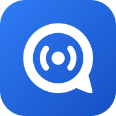
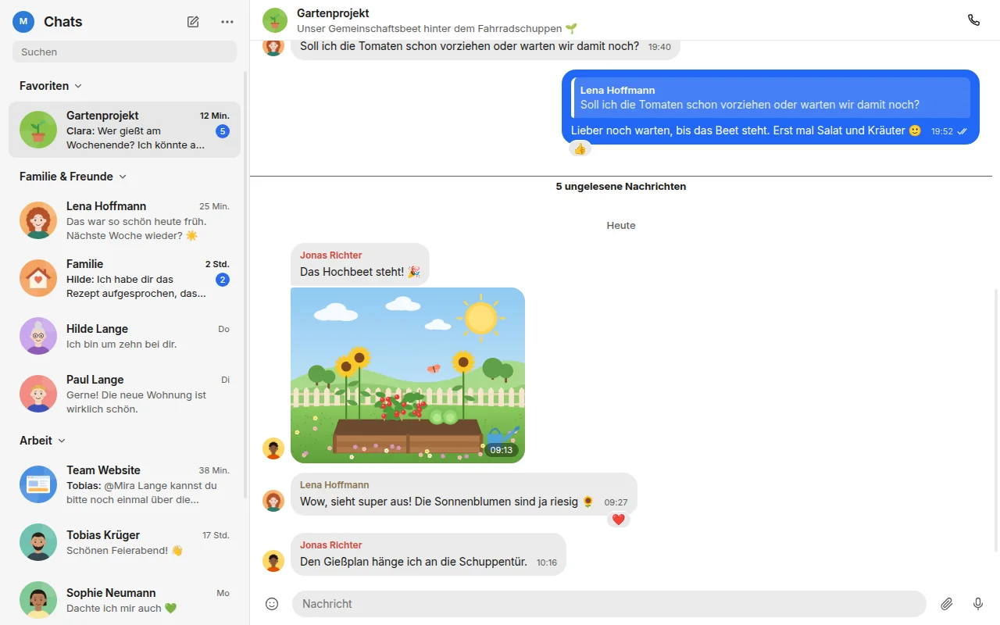
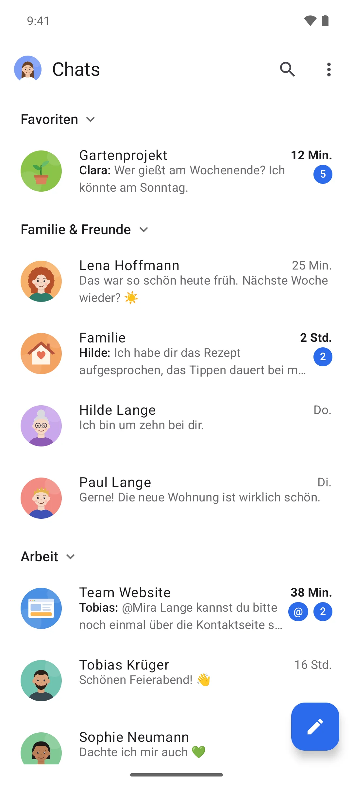
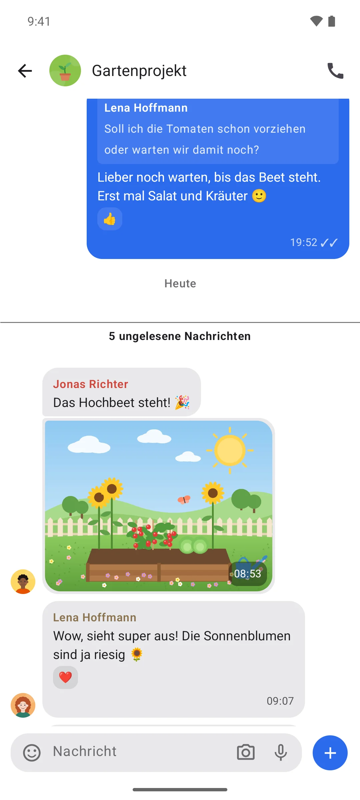
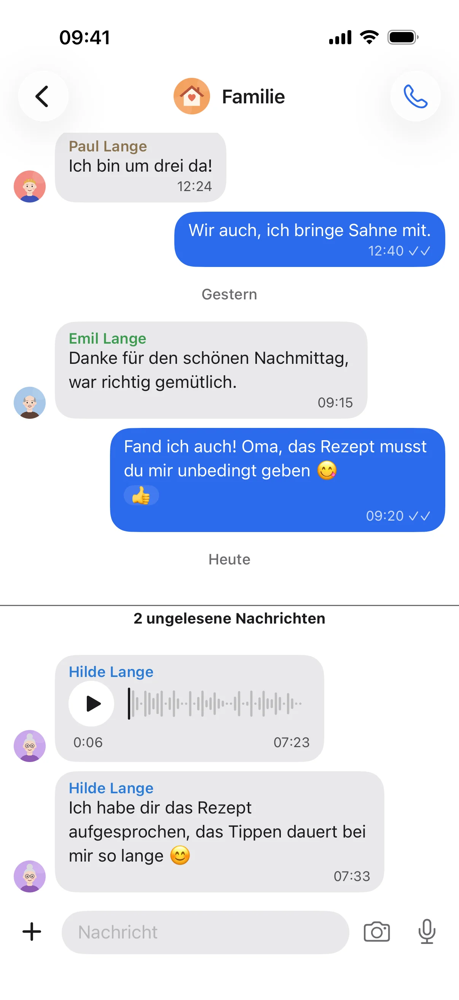

<div align="center">



# Wolkenfunk

<p>
  <b>Schnelle, native Apps für <a href="https://nextcloud.com/talk/">Nextcloud Talk</a></b><br>
  für Windows, macOS, Linux und Android, bald auch für iOS
</p>

<p>
  <a href="#herunterladen">Herunterladen</a> ·
  <a href="#funktionen">Funktionen</a> ·
  <a href="#was-du-brauchst">Voraussetzungen</a> ·
  <a href="https://wolkenfunk.org">Webseite</a> ·
  <a href="#für-entwickler">Für Entwickler</a>
</p>

<picture>
  <source media="(prefers-color-scheme: dark)" srcset="website/public/screenshots/desktop-ungelesen-dunkel.webp">
  
</picture>

</div>

Wolkenfunk macht aus deiner eigenen Nextcloud einen Messenger für Computer und Handy.
Chats öffnen sofort, auch ohne Netz, und ein Anruf klingelt wie ein Telefonat.
Die App spricht nur mit deinem Server: kein zusätzliches Konto, kein Tracking.

<sub>*Wolkenfunk is a fast, native client for Nextcloud Talk. This README and the app are in German for now.*</sub>

## Herunterladen

| System | Download | Läuft auf | Updates |
|---|---|---|---|
| **Windows** | [Wolkenfunk-Setup.exe](https://pkg.wolkenfunk.org/windows/Wolkenfunk-Setup.exe) | Windows 10 und 11, 64-Bit | automatisch |
| **macOS** | [Wolkenfunk.dmg](https://pkg.wolkenfunk.org/mac/Wolkenfunk.dmg) | macOS 12 oder neuer, Intel und Apple Silicon | von Hand: neue `.dmg` laden |
| **Debian, Ubuntu** | [wolkenfunk_amd64.deb](https://pkg.wolkenfunk.org/apt/wolkenfunk_amd64.deb) | ab Debian 12 und Ubuntu 22.04, x86_64 | mit den Systemupdates |
| **Linux allgemein** | [Wolkenfunk-x86_64.AppImage](https://pkg.wolkenfunk.org/appimage/Wolkenfunk-x86_64.AppImage) | alle Distributionen, x86_64 | automatisch |
| **Android** | [wolkenfunk.apk](https://pkg.wolkenfunk.org/android/wolkenfunk.apk) | Android 8 oder neuer | von Hand: neue APK darüber installieren |
| **iOS** | bald im App Store | iPhone, iOS 17 oder neuer | |

Die Links zeigen immer auf die neueste Version. Flathub ist in Vorbereitung.

Wolkenfunk ist noch in Entwicklung, das hier sind frühe Testversionen. Windows und macOS warnen
beim ersten Start, weil die Pakete noch nicht signiert sind. So kommst du daran vorbei:

<details>
<summary><b>Windows</b></summary>

Die Installation braucht keine Administratorrechte. Windows zeigt beim ersten Start
„Der Computer wurde durch Windows geschützt“ und einen unbekannten Herausgeber.
Klicke auf „Weitere Informationen“ und dann auf „Trotzdem ausführen“.

Prüfsummen: [SHA256SUMS](https://pkg.wolkenfunk.org/windows/SHA256SUMS)
</details>

<details>
<summary><b>macOS</b></summary>

Öffne die `.dmg` und ziehe Wolkenfunk in den Ordner „Programme“. Beim ersten Start meldet macOS
„„Wolkenfunk“ nicht geöffnet“:

1. Klicke auf „Fertig“. Der blaue Knopf „In den Papierkorb legen“ löscht die App.
2. Öffne Systemeinstellungen › Datenschutz & Sicherheit und scrolle zum Abschnitt „Sicherheit“.
3. Klicke bei „„Wolkenfunk“ wurde blockiert“ auf „Dennoch öffnen“ und bestätige mit Passwort oder Touch ID.

Das ist nur beim ersten Mal nötig.

Prüfsummen: [SHA256SUMS](https://pkg.wolkenfunk.org/mac/SHA256SUMS)
</details>

<details>
<summary><b>Debian und Ubuntu</b></summary>

Das Paket richtet beim Installieren die Wolkenfunk-Paketquelle ein. Updates kommen danach mit den
normalen Systemupdates.

```sh
sudo apt install ./wolkenfunk_amd64.deb
```

Oder nur die Paketquelle einrichten und dann installieren:

```sh
sudo curl -fsSLo /etc/apt/sources.list.d/wolkenfunk.sources \
  https://pkg.wolkenfunk.org/apt/wolkenfunk.sources
sudo apt update && sudo apt install wolkenfunk
```

Die Pakete sind signiert mit dem Schlüssel `F980 BE28 D9EA 63A0 7A86 6E13 3641 FF50 244C 4126`
([öffentlicher Schlüssel](https://pkg.wolkenfunk.org/apt/wolkenfunk.asc)).

Prüfsummen: [SHA256SUMS](https://pkg.wolkenfunk.org/apt/SHA256SUMS)
</details>

<details>
<summary><b>AppImage</b></summary>

Eine Datei für alle Distributionen, ohne Installation und ohne Administratorrechte.

```sh
chmod +x Wolkenfunk-x86_64.AppImage
./Wolkenfunk-x86_64.AppImage
```

Prüfsummen: [SHA256SUMS](https://pkg.wolkenfunk.org/appimage/SHA256SUMS)
</details>

<details>
<summary><b>Android</b></summary>

Beim Öffnen der APK fragt Android, ob dein Browser oder Dateimanager Apps installieren darf:
Erlaube das unter „Aus dieser Quelle zulassen“. Warnt Google Play Protect vor einer unbekannten App,
wähle „Trotzdem installieren“.

Für eine neue Version lädst du die APK erneut und installierst sie über die alte. Konto und Chats
bleiben erhalten. Kleinere Varianten für nur einen Prozessortyp liegen im
[Download-Ordner](https://pkg.wolkenfunk.org/android/).

Die APK ist signiert mit dem Zertifikat (SHA-256)
`FC:2D:D9:F9:C5:92:4D:A3:73:40:8E:DD:31:00:12:65:4F:2D:D0:47:F6:C6:77:B8:A8:F0:E8:A6:09:BC:42:99`.
Prüfen kannst du das mit `apksigner verify --print-certs wolkenfunk.apk` oder auf dem Handy mit der
App AppVerifier.

Prüfsummen: [SHA256SUMS](https://pkg.wolkenfunk.org/android/SHA256SUMS)
</details>

## So sieht es aus

<p align="center">
  <picture>
    <source media="(prefers-color-scheme: dark)" srcset="website/public/screenshots/android-chats-dunkel.webp">
    
  </picture>
  &nbsp;&nbsp;
  <picture>
    <source media="(prefers-color-scheme: dark)" srcset="website/public/screenshots/android-ungelesen-dunkel.webp">
    
  </picture>
  &nbsp;&nbsp;
  <picture>
    <source media="(prefers-color-scheme: dark)" srcset="website/public/screenshots/ios-sprachnachricht-dunkel.webp">
    
  </picture>
</p>

<p align="center"><sub>Chatliste und Gruppenchat auf Android, Sprachnachricht auf dem iPhone.</sub></p>

## Funktionen

- **Chats mit Kategorien.** Du ordnest Chats in eigene Kategorien wie „Familie & Freunde“ oder
  „Arbeit“, Favoriten stehen oben. Die Kategorien kommen vom Server und sind auf allen Geräten
  gleich, auch im Browser.
- **Weiterlesen, wo du aufgehört hast.** Ein Chat öffnet sich an der Linie „5 ungelesene
  Nachrichten“. Trenner mit „Heute“, „Gestern“ oder dem Datum gliedern den Verlauf.
- **Sprachnachrichten, Bilder und Anhänge.** Dazu Antworten auf einzelne Nachrichten, Reaktionen
  und Lesebestätigungen.
- **Nachrichten bearbeiten und löschen.** Eigene Nachrichten änderst du noch 24 Stunden lang,
  löschen kannst du sie jederzeit. Beides gilt für alle im Chat.
- **Anrufe mit Ton und Video,** zu zweit oder in der Gruppe. Am Computer teilst du auch deinen
  Bildschirm.
- **Benachrichtigungen, die ankommen.** Auf Android melden sich Nachrichten und Anrufe auch bei
  beendeter App. Du antwortest direkt aus der Benachrichtigung oder markierst den Chat als gelesen.
  „Nicht stören“ aus deinem Nextcloud-Status wird beachtet.
- **Mehrere Konten.** Du bist mit mehreren Nextclouds gleichzeitig angemeldet und wechselst über
  deinen Avatar. Eine Zahl daran zeigt, wo Neues wartet, und Anrufe klingeln in jedem Konto.
- **Offline nutzbar.** Chats liegen auf dem Gerät. Was du ohne Netz schreibst, geht raus, sobald
  die Verbindung wieder steht.
- **Hell, dunkel und deine Akzentfarbe.**
- **Open Source,** unter AGPL-3.0.

Mehr dazu mit Bildern auf [wolkenfunk.org/funktionen](https://wolkenfunk.org/funktionen/).

## Was du brauchst

- **Ein Konto auf einer Nextcloud mit Talk.** Wolkenfunk braucht Talk 23 oder neuer, das gehört zu
  Nextcloud 33. Kategorien gibt es ab Talk 24.
- **Für Gruppenanrufe das „High-Performance-Backend“** von Talk auf dem Server. Ob es eingerichtet
  ist, weiß die Person, die deine Nextcloud betreibt.

Und so geht es los:

1. Wolkenfunk installieren und öffnen.
2. Die Adresse deiner Nextcloud eingeben, zum Beispiel `cloud.example.org`.
3. Im Browser anmelden und den Zugriff erlauben. Danach erscheinen deine Chats.

## Was noch fehlt

- **iOS:** Die App gibt es noch nicht im App Store.
- **Am Computer** kommen Benachrichtigungen nur, solange Wolkenfunk läuft. Die App bleibt dafür im
  Tray, und in den Einstellungen gibt es „Beim Anmelden starten“.
- **Ende-zu-Ende-verschlüsselte Anrufe** kann Wolkenfunk noch nicht.
- **Sprache:** Die Oberfläche ist bisher nur deutsch.

Fehler und Wünsche nimmt die [Issue-Liste](https://github.com/raph-ael/nextcloud-talk-legacy/issues) entgegen.

## Für Entwickler

Ein gemeinsamer Kern in Rust enthält Protokoll, Sync, Cache und Anruflogik. Darüber liegt für jedes
System eine eigene Oberfläche: Kotlin mit Jetpack Compose auf Android, Swift auf iOS, Electron mit
React am Computer.

```
core/          Rust-Kern mit Bindings für Kotlin, Swift und Node
android/       Kotlin + Jetpack Compose
ios/           Swift (SwiftUI + UIKit)
desktop/       Electron + React + TypeScript
push-proxy/    Push-Proxy (FCM/APNs) für das Nextcloud-Push-Protokoll
design/        Icon und Design-Tokens
website/       wolkenfunk.org
```

- [Bauen und entwickeln](docs/development.md): Voraussetzungen, Befehle je Plattform, Eigenheiten des Servers
- [Releases](docs/release.md): Kanäle, Updates und der Weg zu einer neuen Version
- Wie sich die Apps verhalten:
  [Chat](docs/chat.md) ·
  [Anhänge](docs/attachments.md) ·
  [Anrufe](docs/calls.md) ·
  [Benachrichtigungen](docs/notifications.md) ·
  [Verbindungsanzeige](docs/connection.md) ·
  [Mehrere Konten](docs/accounts.md) ·
  [Kategorien](docs/categories.md) ·
  [Gruppen](docs/groups.md) ·
  [Einstellungen](docs/settings.md)

## Lizenz und Dank

Wolkenfunk steht unter der [AGPL-3.0](LICENSE). Es ist ein unabhängiges Projekt und nicht mit der
Nextcloud GmbH verbunden.

Die Bedienkonzepte orientieren sich an den [Signal-Apps](https://github.com/signalapp).
Es wird kein Signal-Code übernommen.
